<!--
  Profile README for github.com/aryxett (Aryan Patil).
  Layout & animation style inspired by: github.com/Prathameshkhairnarr
  Anime touch: Solo Leveling — hero-arise-banner.gif (wide banner crop)
  on top, Sung Jinwoo
  beside the bio. Custom animated cards live in ./assets.
  Every claim here is something Aryan can explain in an interview.
-->

<!-- Header — Solo Leveling: Sung Jinwoo "ARISE" (animated GIF, wide banner 498x160) -->

<!-- Open to work -->

<!-- System notification — animated typing (Solo Leveling style) -->

<h2 align="center"> Why hire me</h2>

<table align="center" width="100%">
<tr>
<td width="33%" valign="top" align="center">

<h3>Cloud-first fresher</h3>

Hands-on with <b>AWS core services</b>: EC2, IAM, S3, VPC, CloudFront and CloudWatch. I launch Linux instances, set up IAM roles and policies, and lock things down with security groups.

</td>
<td width="33%" valign="top" align="center">

<h3>Strong Python &amp; Linux base</h3>

Completed <b>Linux (RHEL)</b> and <b>CCNA</b> training courses at SevenMentor: CLI, users and permissions, services, IP addressing, subnets and routing basics.

</td>
<td width="33%" valign="top" align="center">

<h3>I build real AI products</h3>

Voice agents, multi-agent systems and computer vision apps, built end to end: frontend, <b>FastAPI</b> backend, database and deployment.

</td>
</tr>
</table>

<!-- About me — Sung Jinwoo on the RIGHT, vertically centred with the bio.
     Table tags are flush-left with NO indentation and NO blank lines
     around them: indented lines after a blank line make GitHub render
     them as a code block. -->
<table align="center" width="100%">
<tr>
<td width="55%" valign="top">
<h2> About me</h2>
Hey, I'm <b>Aryan Patil</b> — a <b>B.Tech CSE student</b> at Sandip University, Nashik, building my career in **Cloud Computing with AWS**.

- ☁️ **Learning:** AWS Cloud Computing at SevenMentor (in progress)
- 🐧 **Completed:** Linux (RHEL) and CCNA training courses
- 🌐 **Google Cloud:** Arcade Facilitator · Cloud Computing Foundations
- 🏁 **Hackathon:** Team Lead, MindBridge · Faraway International Hackathon, Round 2
- 💼 **Experience:** Full Stack Web Development Intern, Edu-versity (2025)
- 📍 **Based in:** Nashik, India · open to Pune, Mumbai, Bengaluru, Hyderabad
</td>
<td width="45%" align="center" valign="middle">

</td>
</tr>
</table>

<h2 align="center"> How I deploy on cloud</h2>

<h2 align="center"> Featured projects</h2>

| | Project | What it is | Stack |
|:-:|:--|:--|:--|
| 🤖 | [**DESKSHWETA**](https://github.com/Prathameshkhairnarr/DESKSHWETA) | Hindi/English desktop voice assistant with a 3D VRM avatar and multi-provider AI failover (Groq → Gemini → GitHub Models) | Python · Gemini · Edge-TTS · Playwright |
| 🛡️ | [**ElderCare AI**](https://github.com/Prathameshkhairnarr/ElderCareAI) | Voice-first safety platform for seniors with SMS scam detection (XGBoost + TF-IDF, 0–100 risk score) | Flutter · FastAPI · Firebase · PostgreSQL |
| 🚨 | **Rakshika** | Hindi/Hinglish emergency voice agent reachable over phone (LiveKit SIP) with weather, earthquake and hospital APIs | Python · LiveKit · Gemini · Deepgram |
| 🧠 | [**MindBridge**](https://github.com/Prathameshkhairnarr/mind-bridge) · [live](https://mind-bridge-smoky.vercel.app) | Three-tier multi-agent system for detection, support and resource routing | React · FastAPI · LLMs · AI Agents |

<h2> Toolbelt</h2>

<b>☁️ Cloud &amp; Infra</b>

<b>🤖 AI &amp; Product</b>

<b>⚙️ Engineering</b>

<table align="center" width="100%">
<tr>
<td width="50%" valign="top">
<h3>🖥️ aryan@cloud-lab</h3>

</td>
<td width="50%" valign="top">
<h3>📊 Stats</h3>

</td>
</tr>
</table>

<h2> GitHub activity</h2>

<!-- Footer -->

<b>Hiring a fresher for Cloud / DevOps? <a href="https://www.linkedin.com/in/aryan-patil-626a8828b">Let's talk.</a></b>

<i>⚔️ "Arise — from the weakest hunter to the Shadow Monarch of the Cloud."</i>

